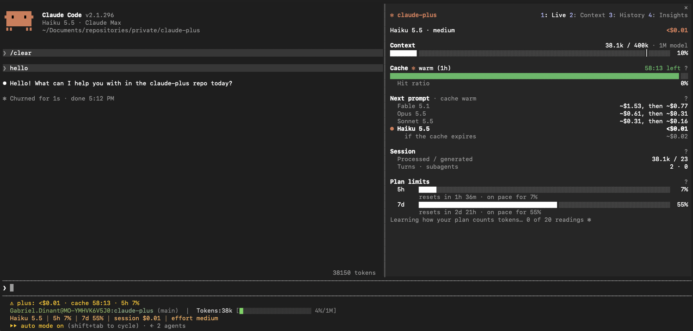
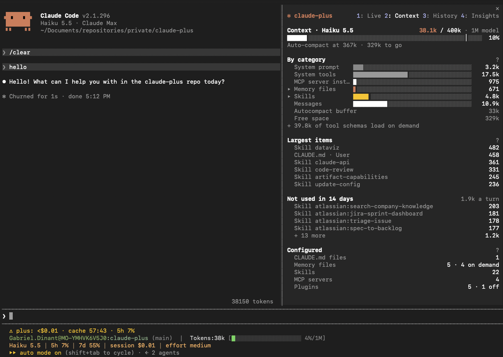
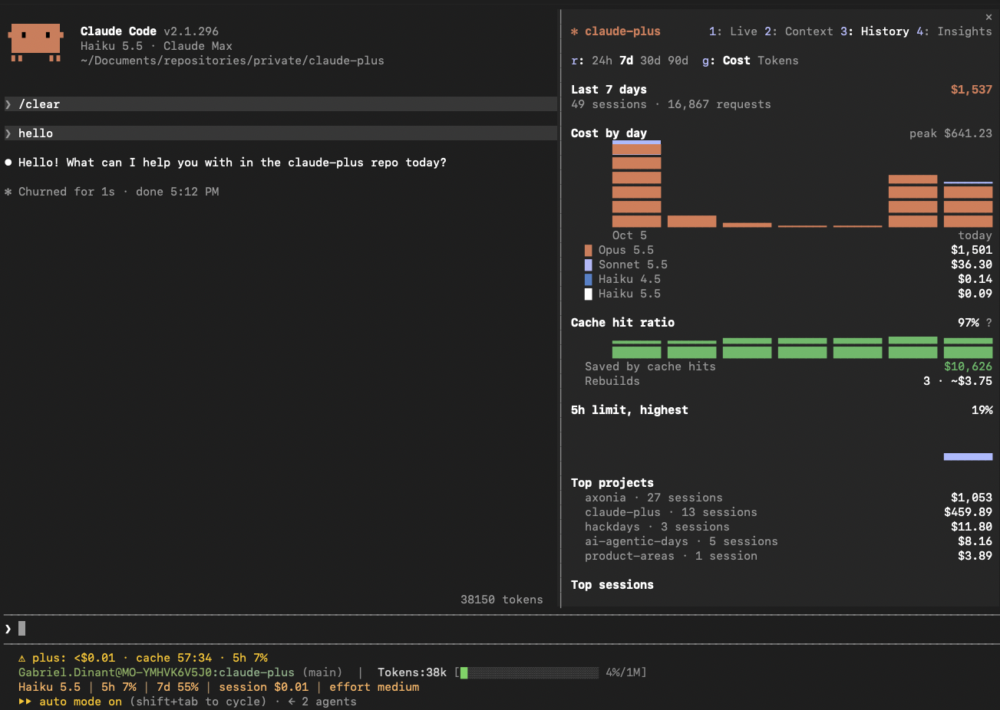
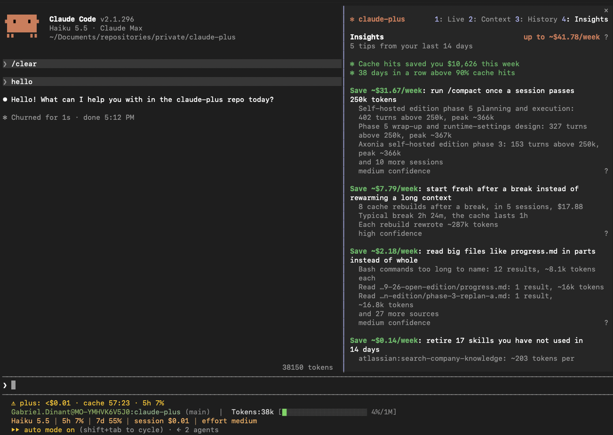

# claude-plus

Token, cache and cost visibility for Claude Code.
claude-plus draws a live pane beside the conversation with what each session costs, what fills its context, when its cache goes cold, how fast it uses your plan's limits, from a subscription's 5h and 7d windows to an enterprise monthly spend limit, and tips that save tokens.
A local daemon reads your Claude Code transcripts and keeps their history; nothing leaves your machine.



## Install

claude-plus runs on macOS and Linux and needs Claude Code 2.1.296 or newer.

Install the binary with Homebrew:

```bash
brew install gdevxy/tap/claude-plus
```

Or with the install script, which puts it in `~/.local/bin`:

```bash
curl -fsSL https://github.com/gdevxy/claude-plus/releases/latest/download/install.sh | sh
```

The script checks the archive against the release's `SHA256SUMS`, which guards against a broken download but comes from the same place as the archive, so it does not prove who built it.
It runs nothing until it has arrived whole, so a dropped connection installs nothing.

Then add the pane to Claude Code:

```bash
claude-plus install
```

`claude-plus install` shows the `claude plugin` commands it runs and asks before it runs them, because Claude Code records the marketplace and the plugin in `~/.claude/settings.json`; `--yes` agrees without asking.
It then starts the daemon, which imports your history in the background.
Start a new Claude Code session: the pane docks beside the conversation when the terminal is at least 144 columns wide, and `/plus` opens it at any width.

The mod alone can also be installed from Claude Code's prompt; it still needs the `claude-plus` binary on `PATH`:

```
/plugin install plus --marketplace gdevxy/claude-plus
```

## The pane

The pane has four views, and the keys 1 to 4 switch between them.

### 1. Live

The current session at a glance: what it costs, how long the cache stays warm, and how fast you use your 5h and 7d subscription windows.
The account the session bills to is named under the model.
An enterprise spend limit shows in dollars once you set a budget.
Next prompt compares what your next message would cost on each model, with the cache warm and after it expires, so you know what a model switch really costs.


### 2. Context

What fills the context window, by category, and how far you are from auto-compact.
It lists the largest items and the skills, tools and memory files you configured but have not used in 14 days, with what each costs every turn.



### 3. History

Cost per day and model, cache hit ratio, what the cache saved you, and your top projects and sessions.
`r` cycles the range between 24h, 7d, 30d and 90d, and `g` switches between cost and tokens.
`a` switches between the current account, your other accounts and all of them.



### 4. Insights

Ranked tips drawn from your own sessions, each with the weekly saving it promises and how confident claude-plus is.
Each tip names the sessions and files behind it, so you can see where the tokens went.



### Alerts

claude-plus shows a toast when the cache is about to go cold, when the 5h limit would run out before its reset at the current pace, and when the context nears auto-compact.
Turn them off with the `alerts` option of the mod.
The `chime` option, off by default, also plays a soft chime with the cache alert.
Both options are set in Claude Code's plugin settings for `plus`.

## Accounts and budgets

claude-plus keeps each account apart: logging out of a company account and into a private one never mixes their limits, History or tips.
It learns which account is signed in from Claude Code's `.claude.json`, which it only reads.
An API key, a gateway (`ANTHROPIC_BASE_URL`) or Bedrock, Vertex or Foundry each count as their own account.
A session is Unknown when claude-plus cannot tell its account, which is the case for most sessions recorded before the accounts upgrade.
Unknown sessions count under All accounts only, so History, `stats` and the budget of an account leave them out.

Sessions run in the Claude desktop app are attributed to the account the desktop app is signed in to, even when the CLI is signed in to another one.
claude-plus reads the session list the desktop app keeps in `~/Library/Application Support/Claude/claude-code-sessions` (`~/.config/Claude/claude-code-sessions` on Linux) on every import and every minute in the daemon, and only reads it.
An account seen only there is called `Desktop account <first 8 characters of its id>` until the CLI signs in to it or you rename it.
`claude-plus doctor` shows how many desktop session files it read and how many it skipped, and says so when part of the folder cannot be read.
`claude-plus import` names skipped files only when it imports locally; when the daemon runs, they are in `daemon.log`.

You attribute the remaining Unknown sessions yourself, by project folder and days:

```bash
claude-plus accounts assign max --project '~/private/*' --dry-run
claude-plus accounts assign max --project '~/private/*'
claude-plus accounts assign enterprise --since 2026-06-01 --until 2026-09-30
```

An account is named by its id, its label as `claude-plus accounts` lists it, or any part of the label that only one account has, in any case.
A name that matches no account, or several, is refused with the accounts it could mean.

`--project` matches the session's working directory, where `*` matches anything, `/` included; quote it so the shell leaves it alone.
`--since` and `--until` are days in local time, both included.
`assign` only touches Unknown sessions and never overrides an attribution claude-plus made itself.
`--dry-run` prints what would change, and `claude-plus accounts unassign` with the same options makes assigned sessions Unknown again.
Moving an attribution also moves the rate-limit samples of that session to the new account.
The 5h calibration (`Learning how your plan counts tokens… x of 20 readings`) is kept per account, so it starts over once after the upgrade.

`claude-plus budget set 700` sets a monthly budget for the current account, reset on the 1st at 00:00 UTC.
With a reported spend limit it turns the percent into dollars.
Without one it is measured against what Claude Code on this machine spent.
The pane warns once per period and account when the pace would run out before the reset, and again at 90% used.

Prices default to Anthropic's own.
An optional `~/.claude-plus/prices.toml` (or `$CLAUDE_PLUS_HOME/prices.toml`) overrides them, and it needs only the models whose prices differ, for example:

```toml
[models.claude-opus-5-5]
input = 3
output = 15
cache_read = 0.15
```

The daemon reads `prices.toml` when it starts, and costs already stored keep the price they were imported with.
After editing it, run `claude-plus daemon stop` and then `claude-plus reindex`; the next Claude Code session restarts the daemon with the new prices.

## Upgrade

Upgrade the binary with `brew upgrade claude-plus` or by running the install script again.
The next Claude Code session restarts the daemon on the new version and updates the mod in place; that session still shows the pane it loaded, and the sessions started after it show the new one.
An older `claude-plus` found first on `PATH` never replaces a newer mod: `claude-plus install` keeps a newer mod in `~/.claude-plus/marketplace` and says so.
When the `plus` mod comes from another marketplace, such as the GitHub one above, `claude-plus install` asks before it points the `claude-plus` marketplace at its own folder.
If that mod is newer than the binary, it stops instead and changes nothing: upgrade `claude-plus`, or run `claude plugin uninstall plus@claude-plus` first to switch to the binary's version.
Until `claude-plus install` or the next session updates the mod, a pane from before accounts and budgets may show a raw `budget` label next to its limits.

## Uninstall

```bash
claude-plus uninstall
```

This removes the mod and its marketplace from Claude Code and stops the daemon; `--purge` also deletes `~/.claude-plus` with the history claude-plus keeps.
claude-plus marks its data directory with a `.claude-plus-data` file only when it created the directory or found it empty.
It never stores its data in a `data.db` that another program made: it creates `data.db` with a claude-plus stamp in its header, and refuses any `data.db` without that stamp, leaving the file as it is and asking you to move it aside.
`--purge` deletes only a marked directory, and in it only `data.db` when the file carries the stamp, and the daemon's files when they were created after the mark.
It keeps anything else it finds there, and names it.
It refuses a symlink (with or without a trailing `/`), your home directory, a directory that holds or sits inside the Claude Code directory, and one without the mark.
Run `claude-plus uninstall` before you remove the binary with `brew uninstall claude-plus`, or delete `~/.local/bin/claude-plus`.

## Commands

| Command | What it does |
|---|---|
| `claude-plus install` | Add the pane to Claude Code and start the daemon. |
| `claude-plus uninstall [--purge]` | Remove the pane and stop the daemon, and with `--purge` delete the data. |
| `claude-plus stats [--days N] [--account <account>]` | Print daily cost per model. |
| `claude-plus export --format json\|csv [--account <account>]` | Print stored usage per day, project, account and model. |
| `claude-plus accounts [rename <account> <label>]` | List the accounts claude-plus knows with this month's spend, or rename one. |
| `claude-plus accounts assign <account> [--project <glob>] [--since <day>] [--until <day>] [--dry-run]` | Attribute Unknown sessions to an account. |
| `claude-plus accounts unassign [--project <glob>] [--since <day>] [--until <day>] [--dry-run]` | Make assigned sessions Unknown again. |
| `claude-plus budget set <usd> \| show \| clear [--account <account>]` | Set, show or clear the monthly budget of an account. |
| `claude-plus doctor` | Check the binary, daemon, mod, Claude Code version, transcript retention and the desktop app's sessions. |
| `claude-plus import` | Read new transcripts into the store, with progress. |
| `claude-plus reindex` | Rebuild derived tables from stored records. |
| `claude-plus daemon [--ensure [--unless-stopped]]` | Run the daemon, or start it detached unless one answers; with `--unless-stopped`, leave one stopped by `daemon stop` stopped. |
| `claude-plus daemon stop` | Stop the running daemon and keep it stopped: open panes leave it alone until `/plus`, a new session or `--ensure` starts it. |

## Privacy

claude-plus makes no network requests.
The daemon listens only on a Unix socket in `~/.claude-plus`, readable by you alone, and never edits Claude Code's files.
`CLAUDE_PLUS_HOME` moves the data directory and `CLAUDE_CONFIG_DIR` the Claude Code directory.
`CLAUDE_PLUS_HOME` must be an absolute path; a relative `CLAUDE_CONFIG_DIR` is read from the working directory, as Claude Code reads it.

## License

MIT
